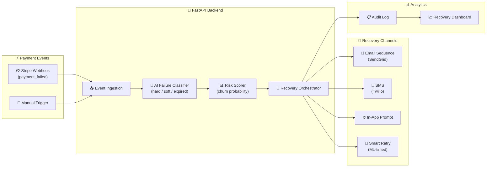
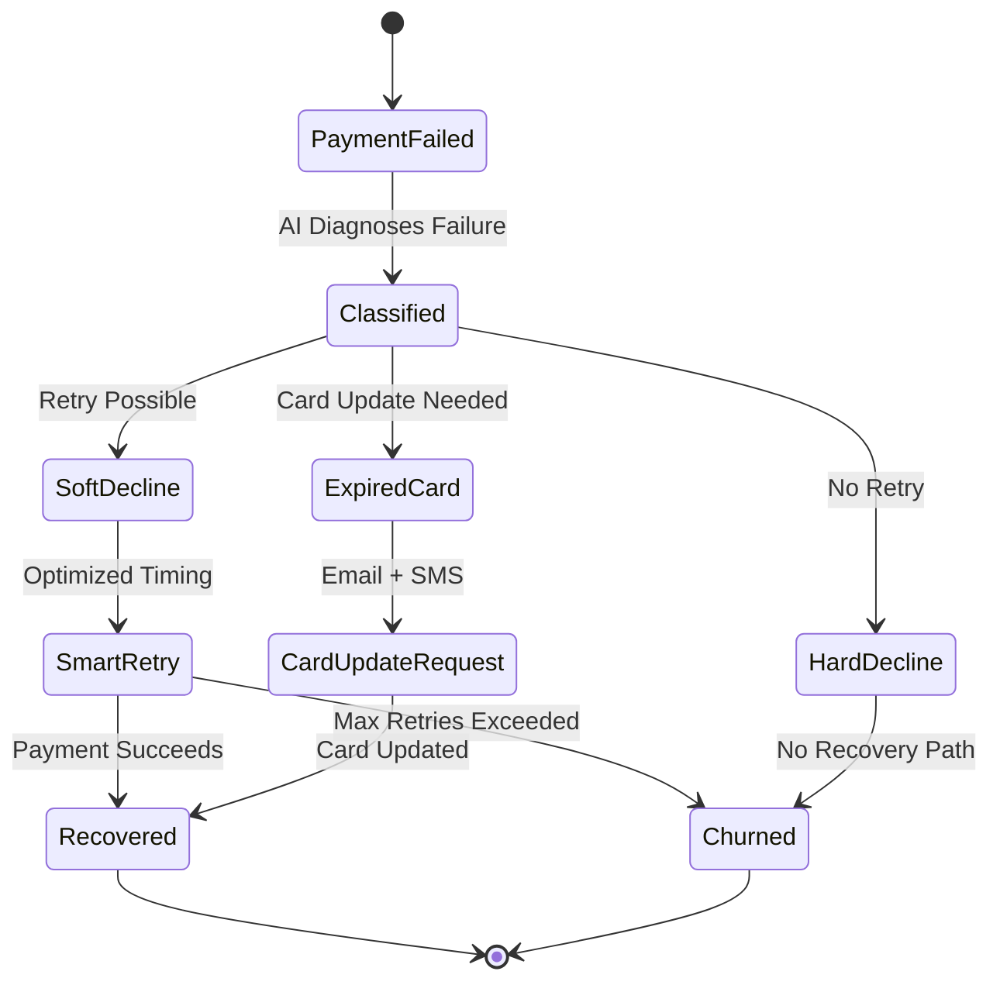

<div align="center">

# 💰 RecoverAI

**Autonomous Revenue Recovery Agent**

[](https://github.com/harinish45/AI-Revenue-Recovery/actions/workflows/ci.yml)
[](LICENSE)
[](https://python.org)
[](docker-compose.yml)

> *AI agent that detects failed payments and autonomously runs recovery workflows — without moving money*

`Detect → Diagnose → Decide → Recover → Audit`

[📋 TODO](TODO.md) · [📄 PRD](PRD.md) · [🚀 Deploy](DEPLOY.md)

</div>

---

## 🏗️ System Architecture



---

## 🚀 Quick Start

```bash
git clone https://github.com/harinish45/AI-Revenue-Recovery.git
cd AI-Revenue-Recovery

# Linux/Mac
./bootstrap.sh

# Windows
./bootstrap.ps1

# Or Docker
docker compose up --build
```

---

## 📊 Recovery Flow State Machine



---

## 📁 Structure

```
AI-Revenue-Recovery/
├── 🌐  frontend/          # React dashboard
├── 🐍  backend/           # FastAPI + ML models
├── 📊  docs/              # Architecture docs
├── 🔧  scripts/           # Automation scripts
├── 🐳  docker-compose.yml
└── 📋  RecoverAI-standalone.html  # Demo
```

---

<div align="center">
<a href="LICENSE">MIT License</a> · Built by harinish45
</div>